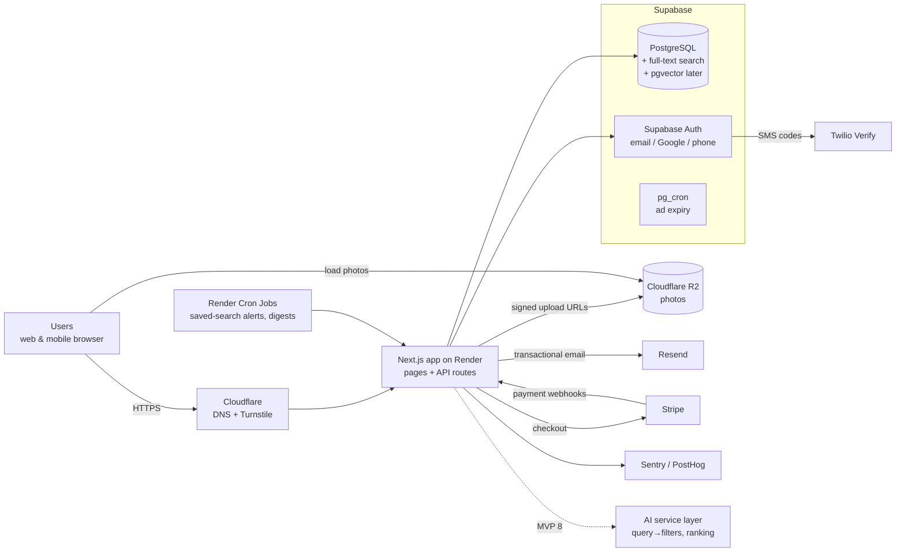

# Architecture & Tech Stack — Desinetwork

| Field | Value |
|---|---|
| Version | **1.0 (Final)**, decisions A1–A4 in Section 12 |
| Domain | **desinetwork.co** |
| Built by | **Claude Code** (AI coding), task by task, reviewed by product owner |
| Date | 24 Nov 2026 |
| Based on | PRD v1.0 (`prd.md`) |
| Principle | Build on free tiers now; switch to paid plans only at launch or when a limit is hit |

---

## 1. Architecture Principles
1. **One codebase, simple to run** — a single full-stack Next.js app (TypeScript). No microservices until needed.
2. **Managed services over servers** — we run no servers ourselves; providers handle backups, scaling and security patches.
3. **Swap-friendly** — every external service (search, AI, SMS, email, storage, payments) sits behind our own small interface, so we can change providers without rewriting features.
4. **AI-ready from day one** — structured listing data, event logging, a search interface and a moderation pipeline (PRD §8.2).
5. **Secure by default** — database row-level security, no secrets in code, and no card data ever stored by us.

---

## 2. Tech Stack

| Layer | Choice | Free while building | At launch (paid) |
|---|---|---|---|
| Language | **TypeScript** everywhere | — | — |
| Web app (UI + API) | **Next.js** (App Router, server rendering for SEO) + **Tailwind CSS** + **shadcn/ui** components | Free (open source) | — |
| Hosting | **Render** web service | Free (sleeps after 15 min idle; ~1 min wake-up) | Paid instance (no sleep) |
| Database | **PostgreSQL on Supabase** | Free (500 MB DB, pauses after 7 days idle) | Supabase Pro |
| Auth | **Supabase Auth**: email code, Google sign-in, phone code | Free | Included in Supabase |
| Phone verification (SMS) | **Twilio Verify**, connected to Supabase phone auth | Test phone numbers with fixed codes (no cost) | Pay per verification |
| Email | **Resend** + React Email templates | Free (100/day, 3,000/month) | Resend Pro |
| Photo storage | **Cloudflare R2** (S3-compatible) | Free (10 GB, no viewing/egress fees) | Pay per GB beyond free |
| Image processing | **sharp** (resize, compress to WebP, strip location data) | Free | — |
| Search (now) | **Postgres full-text search** + `pg_trgm` (typo tolerance) | Free (built in) | — |
| Search (AI, MVP 8) | **pgvector** in the same Postgres + an AI model for query → filters | Free extension | AI model usage fees |
| Payments | **Stripe** Checkout + webhooks | Test mode (free) | Per-transaction fee only |
| Scheduled jobs | **Supabase pg_cron** (ad expiry) + **Render Cron Jobs** (email digests) | Free | — |
| Maps | **OpenStreetMap + Leaflet** | Free | — |
| Bot protection | **Cloudflare Turnstile** on sign-up and posting | Free | — |
| Error tracking | **Sentry** | Free tier | Paid if volume grows |
| Analytics | **PostHog** (product analytics, funnels) | Free tier | Paid if volume grows |
| Code & CI/CD | **GitHub** + **GitHub Actions** | Free | — |
| Testing | **Vitest** (unit), **Playwright** (end-to-end) | Free | — |
| Domain & DNS | **desinetwork.co** on Cloudflare DNS | Free DNS | Domain renewal |
| Client platform | **Responsive web** (mobile-first, 375px → 1440px); installable PWA later; native apps out of scope | — | — |

---

## 3. System Diagram



---

## 4. Key Flows

### 4.1 Sign up and phone verification (FR-ACC-1/2/3)
1. User signs up with email code or Google (Supabase Auth).
2. Before the first ad, the app asks for a US phone number → Supabase sends a code through Twilio Verify.
3. User enters the code → `profiles.phone_verified = true` → "Verified" badge.
4. Development uses Supabase **test phone numbers** with fixed codes, so no SMS is sent.

### 4.2 Post an ad (T1.2–T1.6)
1. Form loads category fields from `category_fields` (dynamic form).
2. Photos: browser asks the API for a **signed upload URL** → uploads straight to R2 → server resizes with sharp (creates thumbnail + full size, removes GPS data).
3. Submit → **moderation pipeline** runs checks (banned words, duplicates, rate limit, new-user rule) → listing becomes `active` or `pending`.
4. An `activity_events` row is logged (`listing_posted`).

### 4.3 Search (MVP 3 → MVP 8)
- **Now:** `SearchService.search(query, filters, sort, page)` → Postgres full-text search on title + description, filtered by city/category/attributes, with typo tolerance via `pg_trgm`.
- **MVP 8 (AI):** the same interface gets two steps added:
  1. **Query → filters** (T8.A1): AI model turns "room near Edison under 900 veg only" into structured filters shown as editable chips.
  2. **Ranking** (T8.A2): combine keyword score + vector similarity (pgvector embeddings of listings) + freshness.
- The UI does not change when the engine changes.

### 4.4 Featured / Bump payment (MVP 6)
1. User clicks "Feature this ad" → server creates a **Stripe Checkout** session with the current admin-set price.
2. User pays on Stripe's page (we never see card data).
3. Stripe sends a **webhook** → server verifies its signature → creates an `upgrades` row → listing is featured until `ends_at`.
4. A failed or cancelled payment changes nothing.

### 4.5 Moderation pipeline (FR-TSM-3, T5.8)
```
submit → [rate limit] → [banned words] → [duplicate check] → [new-user rule] → (MVP 8: [AI check]) → allow | review | block
```
Each check returns `allow / review / block` + a reason. Adding the AI check later means adding one step; the moderation queue UI stays the same.

---

## 5. Data Model (main tables)

| Table | Key columns |
|---|---|
| `profiles` | id (= auth user), display_name, photo_url, city_id, phone_verified, role (user/moderator/admin), status (active/suspended/banned), created_at |
| `cities` | id, name, state_label, slug, is_active *(country column added later for global scope)* |
| `categories` | id, parent_id (null for top level), name, slug, sort_order, is_active |
| `category_fields` | id, category_id, key, label, type (text/number/select/bool/date), options, required, filterable |
| `listings` | id, user_id, city_id, category_id, title, description, price, status, language, expires_at, view_count, search_vector (tsvector), embedding (vector, MVP 8), created_at |
| `listing_attributes` | listing_id, field_key, value *(typed values for category fields)* |
| `listing_photos` | id, listing_id, r2_key, width, height, sort_order, is_cover, image_hash |
| `conversations` / `messages` | conversation: listing_id, buyer_id, seller_id · message: conversation_id, sender_id, body, read_at |
| `saved_listings` / `saved_searches` | user_id + listing_id · user_id, query, filters (JSON), alert_frequency |
| `blocks` | blocker_id, blocked_id |
| `reports` | id, target_type (listing/user), target_id, reporter_id, reason, status |
| `moderation_actions` | id, moderator_id, target, action, reason, created_at *(audit log)* |
| `prices` | product (featured/bump), amount_cents, duration_days, effective_from *(admin-editable, history kept)* |
| `payments` / `upgrades` | stripe ids, amount, status · listing_id, type, starts_at, ends_at |
| `events` / `businesses` / `reviews` | MVP 7 community extensions |
| `activity_events` | id, user_id/session_id, type (view/search/contact/save/post), city_id, category_id, payload (JSON), created_at |

**Security:** Postgres **row-level security** on every table (for example, a user can only edit their own listings; only moderators can read reports).

---

## 6. AI Layer (for MVP 8)
- One internal module, `lib/ai/`, with functions like `parseSearchQuery()`, `embedText()`, `rankResults()`, `moderateListing()`.
- Provider is chosen by configuration; feature code never calls an AI provider directly.
- Every AI decision is logged (input, output, model, confidence) for review and evaluation (T8.A3).
- Fallback: if the AI fails or is slow (>1.5 s), use normal keyword search.
- Provider decision is deferred to MVP 8.

---

## 7. Security & Privacy
- HTTPS everywhere; secrets in Render/GitHub environment variables, never in code.
- Row-level security in Postgres; server-side permission checks on every API route.
- Rate limiting on login, OTP, posting and messaging; Turnstile on sign-up and posting.
- Uploaded photos: type/size checks, re-encoded with sharp, location data removed.
- Stripe webhooks verified by signature; no card data stored.
- Account deletion removes personal data (CCPA).
- Audit log for all moderator/admin actions.

---

## 8. Environments & Delivery

| Environment | Purpose | Setup |
|---|---|---|
| Local | Development | Supabase CLI (local Postgres + Auth in Docker), Stripe test mode, Twilio test numbers |
| Staging | Test each task before merge | Render free service + free Supabase project |
| Production | Live site | Render paid + Supabase Pro (at launch) |

**Workflow:** feature branch → pull request → GitHub Actions runs lint, type check, unit tests and Playwright tests → merge to `main` → auto-deploy to staging → manual promote to production.

Database changes go through **migration files** (Supabase CLI), never by hand.

---

### 8.1 Building with Claude Code
Because Claude Code writes the code, automated tests are the main safety net. Every task follows this loop:

1. **One task per session/branch.** Name the branch after the task ID (for example `feat/T1.3-post-ad-details`).
2. **Give Claude Code the task row** (ID, task, acceptance criteria) from `prd.md` / this doc.
3. **Tests first:** Claude Code writes tests that check the acceptance criteria, then writes the code until they pass.
4. **Definition of done:** lint + type check + unit tests + Playwright e2e test for the acceptance criteria all pass in CI; mobile (375px) and desktop (1440px) screenshots attached to the pull request.
5. **You review** the pull request and the staging site, then merge.

**Repo guardrails for Claude Code:**
- A `CLAUDE.md` at the repo root holds the project rules: stack, folder structure, coding conventions, "every task needs tests", "never commit secrets", "all DB changes via migration files", "keep external services behind `lib/` interfaces".
- `prd.md` and `architecture.md` live in `/docs` so Claude Code can read them.
- `.env.example` lists every environment variable; real keys stay out of the repo.
- Branch protection on `main`: CI must pass before merge.

## 9. Folder Structure

```
desinetwork/
├─ CLAUDE.md               # rules for Claude Code
├─ docs/                   # prd.md, architecture.md
├─ .env.example
├─ app/                    # Next.js routes (pages + API)
│  ├─ (public)/            # home, city, category, listing pages
│  ├─ (account)/           # my ads, messages, saved, profile
│  ├─ (admin)/             # moderation, users, categories, pricing
│  └─ api/                 # upload URLs, webhooks, search
├─ components/             # UI components (shadcn/ui based)
├─ lib/
│  ├─ db/                  # Supabase client, queries
│  ├─ search/              # SearchService (keyword now, AI later)
│  ├─ moderation/          # check pipeline
│  ├─ storage/             # R2 uploads, image processing
│  ├─ notify/              # email (Resend), SMS (Twilio)
│  ├─ payments/            # Stripe
│  ├─ events/              # activity event logging
│  └─ ai/                  # AI layer (MVP 8)
├─ emails/                 # React Email templates
├─ supabase/
│  ├─ migrations/          # SQL schema changes
│  └─ seed.sql             # 11 cities, categories, fields
├─ tests/
│  ├─ unit/
│  └─ e2e/                 # Playwright
└─ .github/workflows/      # CI/CD
```

---

## 10. Cost Plan
| Phase | Monthly cost |
|---|---|
| **Building (MVP 0–7)** | **$0**: all services on free tiers / test modes |
| **Launch** | Paid: Render instance (no sleep), Supabase Pro, Resend Pro (when >100 emails/day), Twilio per verification, Stripe per transaction, domain name |
| **Later** | AI model usage (MVP 8), more storage/bandwidth as listings grow |

**Known free-tier limits during building:**
- Render free: service sleeps after 15 minutes idle.
- Supabase free: project pauses after 7 days without activity.
- Resend free: 100 emails per day.

---

## 11. Technical Setup Tasks (extends PRD MVP 0)

| ID | Task | Acceptance criteria |
|---|---|---|
| A0.1 | Create GitHub repo + Next.js (TypeScript, Tailwind, shadcn/ui) project; add `CLAUDE.md`, `/docs`, `.env.example`, branch protection | `npm run dev` shows a starter page; `CLAUDE.md` and docs present; direct push to `main` blocked |
| A0.2 | Create Supabase project + set up local Supabase CLI | App connects to local and cloud DB |
| A0.3 | First migration: cities, categories, category_fields, profiles + seed 11 cities & 7 categories | `supabase db reset` loads all seed data |
| A0.4 | Row-level security policies baseline | Automated test: user A cannot edit user B's data |
| A0.5 | Deploy to Render (staging) from `main` | Push to `main` updates the staging URL |
| A0.6 | GitHub Actions CI: lint, type check, unit + e2e tests | Failing test blocks merge |
| A0.7 | Cloudflare R2 bucket + signed upload API | Test upload succeeds; file visible in bucket |
| A0.8 | Resend domain verification + test email | Test email lands in inbox (not spam) |
| A0.9 | Twilio Verify connected to Supabase phone auth; test numbers for dev | Test number receives fixed code in dev; real SMS works on staging |
| A0.10 | Stripe test mode keys + webhook endpoint | Test webhook received and verified |
| A0.11 | Sentry + PostHog connected | Test error appears in Sentry; page view in PostHog |
| A0.12 | `activity_events` table + `logEvent()` helper (PRD T0.6) | View/search/post events are stored |
| A0.13 | Connect **desinetwork.co** to Cloudflare DNS; `staging.desinetwork.co` → Render staging | Both URLs load over HTTPS |
| A0.14 | Responsive check in CI: Playwright runs e2e tests at 375px and 1440px | Tests pass at both sizes |

---

## 12. Decisions Log
| # | Question | Decision |
|---|---|---|
| A1 | Language / framework | **Next.js + TypeScript**, confirmed |
| A2 | Who builds | **Claude Code**: test-first, one task per branch (see §8.1) |
| A3 | Platform | **Responsive web** only; PWA later; no native apps for now |
| A4 | Domain | **desinetwork.co** |
| A5 | Services | Render (hosting), Supabase (DB/auth), Twilio Verify (SMS), Resend (email), Cloudflare R2 (photos), Stripe (payments). Paid plans acceptable when needed |

No open questions. Next: start A0.1 with Claude Code.
